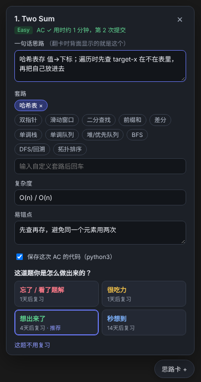
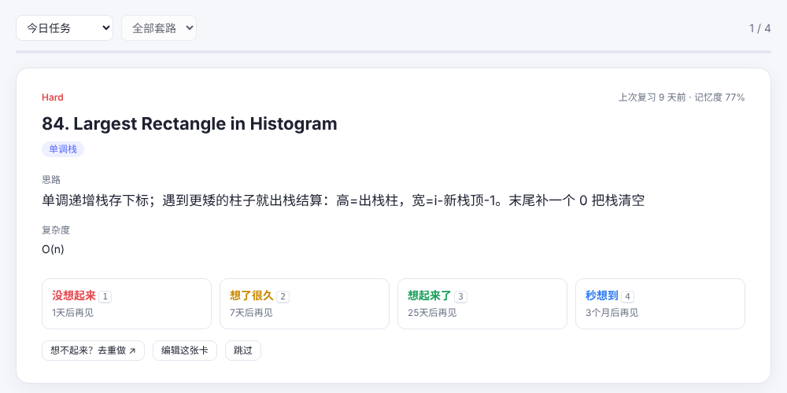

# LeetRecall

**English** | [简体中文](README.zh-CN.md)

> Solve it, forget it, solve it again? LeetRecall turns every problem into a one-line **idea card** and drills you with spaced repetition (FSRS), a few seconds per card.

LeetRecall is a Chrome extension (Manifest V3) for leetcode.com and leetcode.cn. When a submission is accepted, a panel pops up so you can write down the key idea, the pattern, the complexity and the pitfalls, then rate how hard it was. LeetRecall schedules the next review with FSRS. When a card comes up, you **recall the idea from the title first, then flip to check**. Only if you really can't remember do you go back and re-solve it.

<p>
  
  
</p>

## Why

Most LeetCode review tools only answer *"which problem should I review today?"*, and reviewing means re-solving the whole problem, which takes 20+ minutes each time. Anki decks let you flip cards, but someone else wrote the content and you end up pasting screenshots by hand. LeetRecall combines the strengths of both:

| | Typical review extensions | Anki decks | LeetRecall |
|---|---|---|---|
| Auto-capture accepted submissions | ✅ | ❌ | ✅ (Ctrl/⌘+Enter included) |
| Card content | None, or a free-form note | Written by others | **Your own one-line idea**, plus pattern, complexity, pitfalls and accepted code |
| How you review | Re-solve the problem | Flip cards | **Flip cards**; re-solve only when you forget |
| Scheduler | Fixed intervals / FSRS | FSRS / SM-2 | FSRS-4.5 |
| Drill by pattern | Rare | Via tags | ✅ Weakest patterns ranked first, one click to drill |
| Mobile | Rare | ✅ | Export to Anki, then review on AnkiMobile / AnkiDroid |
| Import past solves | Rare | ❌ | ✅ One click imports every problem your account has solved |

## Features

- **Auto-capture**: LeetRecall hooks LeetCode's own `submit` / `check` requests, so both the Submit button and the keyboard shortcut are detected. "Run" test cases and Wrong Answers don't trigger it. If the network hook ever misses, it falls back to watching the on-page result panel. It also records how long you took and how many attempts you made, and uses them to suggest a rating.
- **In-page idea panel**: pops up in the bottom-right corner after an accepted submission. It lives in a Shadow DOM, so it never touches LeetCode's styles. You can also open it any time from the floating button. Typing in the panel won't trigger LeetCode's keyboard shortcuts.
- **FSRS scheduling**: FSRS-4.5 with default parameters, plus configurable target retention and maximum interval. Due cards are sorted by retrievability, so the ones you're most likely to forget come first.
- **Flip-card review**: press Space to flip and 1–4 to rate. Pattern tags are hidden on the front by default, since the tag itself is a hint. If a card has no idea written yet, you can add one right on the back.
- **Three review modes**: today's queue (with daily review and new-card limits), drill by pattern, or a random spot check of all cards.
- **Library**: search by number, title or idea; filter by difficulty and pattern; sort by due date, retrievability or "missing idea first".
- **Stats**: review heatmap, streak, and average retrievability and lapses per pattern, with the weakest patterns first.
- **Import / export**: one-click import of your accepted problems; JSON backup with merge-restore; Markdown notes grouped by pattern; Anki deck (`.txt` with tags).
- **Reminders**: the toolbar badge shows how many cards are due today, and a daily notification reminds you to review.

## Install

LeetRecall isn't on the Chrome Web Store yet. To load it in developer mode:

1. Download or clone this repository.
2. Open `chrome://extensions` and turn on **Developer mode** (top right).
3. Click **Load unpacked** and select the repository root (the folder containing `manifest.json`).
4. Open any LeetCode problem. When the 思路卡 button appears in the bottom-right corner, you're set.

It also works in other Chromium-based browsers such as Edge, Brave and Arc.

## Data & privacy

Everything is stored locally in `chrome.storage.local`. There's no server and no tracking. The extension only talks to leetcode.com / leetcode.cn: it fetches problem metadata, and reads your accepted-problem list when you click Import. To move to another computer, use **Backup JSON** and then **Restore from JSON**.

## Project structure

```
manifest.json
src/
  inject.js       # MAIN world: hooks fetch/XHR, follows submit → check → Accepted
  content.js      # Isolated world: idea panel (Shadow DOM), problem metadata, SPA routing
  panel.css
  background.js   # Service worker: message router, badge count, daily reminder
  fsrs.js         # FSRS-4.5 scheduler (day-level intervals, DST-safe)
  store.js        # Storage layer, review queue, daily limits
pages/
  popup.*         # Toolbar popup
  app.*           # Review / Library / Stats / Settings & import-export
tests/
  fsrs.test.mjs           # node tests/fsrs.test.mjs
  e2e_mock_leetcode.py    # Playwright end-to-end test against a mock LeetCode page
```

Vanilla JS, with no build step and no dependencies.

## Tests

```bash
node tests/fsrs.test.mjs
pip install playwright
CHROME=/path/to/chrome-for-testing python tests/e2e_mock_leetcode.py
```

The end-to-end test loads the extension and walks through Run → Wrong Answer → Accepted → write idea → rate → flip-card review on a mock LeetCode page. Branded Google Chrome no longer supports `--load-extension`, so use Chrome for Testing or Chromium.

## Roadmap

- [ ] Draft the idea automatically from your accepted code (bring your own LLM API key)
- [ ] Built-in problem lists (Blind 75 / NeetCode 150 / Grind 75)
- [ ] Optimize FSRS parameters from your own review history
- [ ] Optional cloud sync
- [ ] Publish to the Chrome Web Store

## License

[MIT](LICENSE)
