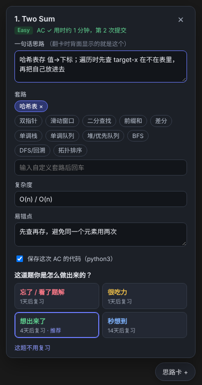
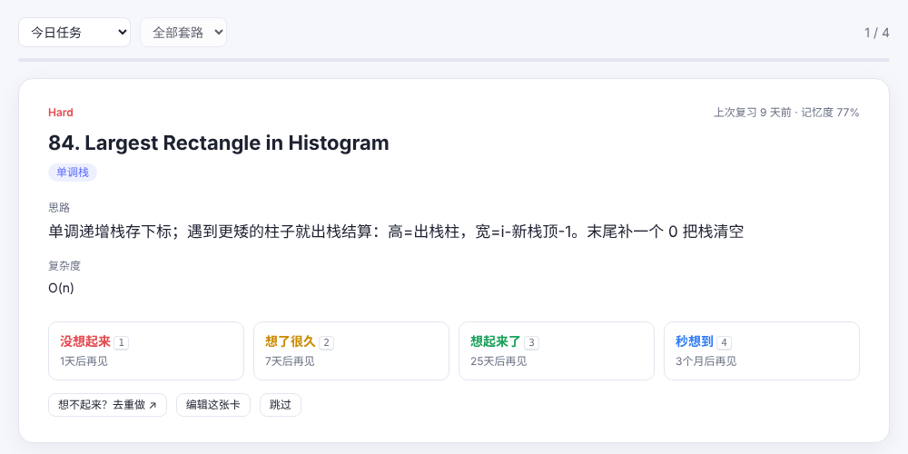

# LeetRecall 思路卡

[English](README.md) | **简体中文**

> 刷完就忘？把每道题浓缩成一张**思路卡**，用间隔重复（FSRS）翻卡复习，几秒一张。

LeetRecall 是一个 Chrome 插件（Manifest V3），支持 leetcode.com 和 leetcode.cn。提交 AC 后会自动弹出面板，你写下一句话思路、套路、复杂度和易错点，按做题时的感觉打个分，插件就用 FSRS 算法排好复习日期。复习时**先看题目自己回想思路，再翻面核对**，真想不起来再去重做原题。

<p>
  
  
</p>

## 为什么做这个

现有的 LeetCode 复习工具大多只解决「哪天该复习哪道题」，复习方式是把整道题重做一遍，一次 20 分钟起步。Anki 卡组能翻卡，但内容是别人写的，还要手动截图贴题。LeetRecall 想把两边的好处合在一起：

| | 常见刷题复习插件 | Anki 卡组 | LeetRecall |
|---|---|---|---|
| AC 后自动记录 | ✅ | ❌ | ✅（Ctrl/⌘+Enter 提交也能识别） |
| 卡片内容 | 无，或附带笔记 | 别人写好的 | **你自己的一句话思路** + 套路 + 复杂度 + 易错点 + AC 代码 |
| 复习方式 | 重做原题 | 翻卡 | **翻卡**，想不起来再重做 |
| 调度算法 | 固定间隔 / FSRS | FSRS / SM-2 | FSRS-4.5 |
| 按套路专项复习 | 少见 | 靠标签 | ✅ 统计页按掌握程度排序，点一下就能专项练 |
| 手机端 | 少见 | ✅ | 导出 Anki 卡组，用 AnkiMobile / AnkiDroid 刷 |
| 导入旧记录 | 少见 | ❌ | ✅ 一键导入你账号里 AC 过的题 |

## 功能

- **自动采集**：拦截 LeetCode 自己的 `submit` / `check` 请求来判断 AC，所以点按钮或用快捷键提交都能识别；「运行」测试用例和 WA 不会误触发。网络钩子万一失效，还会监听页面上的结果面板作为兜底。同时记录用时和提交次数，据此推荐评分。
- **思路卡面板**：AC 后在页面右下角弹出（Shadow DOM，不影响 LeetCode 的样式），也可以随时点右下角的「思路卡」按钮新建或编辑。在面板里打字不会触发 LeetCode 的快捷键。
- **FSRS 调度**：内置 FSRS-4.5 默认参数，目标记忆保持率和最长间隔都能调。今天到期的卡按记忆度从低到高排，最容易忘的先出。
- **翻卡复习**：按空格翻面，按 1–4 评分。正面默认隐藏套路标签，因为标签本身就是提示。翻到还没写思路的卡，可以直接在背面补写。
- **三种复习范围**：今日任务（有每日复习上限和新卡上限）、按套路专项、全部随机抽查。
- **卡片库**：按题号、标题、思路搜索，按难度和套路筛选，按复习时间、记忆度或「没写思路的优先」排序。
- **统计**：复习热力图、连续复习天数、各套路的平均记忆度和遗忘次数，最薄弱的套路排在最前面。
- **导入导出**：一键导入 AC 记录；导出 JSON 备份和合并恢复、按套路分组的 Markdown 笔记、Anki 卡组（`.txt`，含标签）。
- **提醒**：工具栏图标显示今天待复习的数量，每天定时发一条通知。

## 安装

还没上架 Chrome 商店，先用开发者模式加载：

1. 下载或 clone 本仓库。
2. 打开 `chrome://extensions`，打开右上角的「开发者模式」。
3. 点「加载已解压的扩展程序」，选择仓库根目录（就是有 `manifest.json` 的那个文件夹）。
4. 打开任意一道 LeetCode 题，右下角出现「思路卡」按钮就装好了。

Edge、Brave、Arc 等 Chromium 内核的浏览器同样适用。

## 数据和隐私

所有数据都保存在本地的 `chrome.storage.local`，没有服务器，也不收集任何数据。插件只会访问 leetcode.com / leetcode.cn：读取题目信息，以及在你点导入时读取你的 AC 列表。换电脑时用「备份 JSON」再「从 JSON 恢复」即可。

## 项目结构

```
manifest.json
src/
  inject.js       # 页面 MAIN world：hook fetch/XHR，识别 submit → check → AC
  content.js      # 隔离 world：思路卡面板（Shadow DOM）、题目元数据、SPA 路由
  panel.css
  background.js   # Service worker：消息路由、徽标计数、每日提醒
  fsrs.js         # FSRS-4.5 调度（按天计算间隔，兼容夏令时）
  store.js        # 存储层、复习队列、每日上限
pages/
  popup.*         # 工具栏弹窗
  app.*           # 翻卡复习 / 卡片库 / 统计 / 设置与导入导出
tests/
  fsrs.test.mjs           # node tests/fsrs.test.mjs
  e2e_mock_leetcode.py    # Playwright + 模拟 LeetCode 页面的端到端测试
```

纯原生 JS，没有构建步骤，也没有第三方依赖。

## 测试

```bash
node tests/fsrs.test.mjs
pip install playwright
CHROME=/path/to/chrome-for-testing python tests/e2e_mock_leetcode.py
```

端到端测试会加载这个插件，用一个模拟的 LeetCode 页面依次走一遍「运行 → WA → AC → 写思路 → 评分 → 翻卡复习」。注意：正式版 Google Chrome 已不支持 `--load-extension`，请用 Chrome for Testing 或 Chromium。

## Roadmap

- [ ] 根据 AC 代码自动生成思路草稿（接入用户自己的 LLM API key）
- [ ] 题单预设（Blind 75 / NeetCode 150 / Grind 75）
- [ ] 根据自己的复习记录优化 FSRS 参数
- [ ] 可选的云同步
- [ ] 上架 Chrome Web Store

## License

[MIT](LICENSE)
